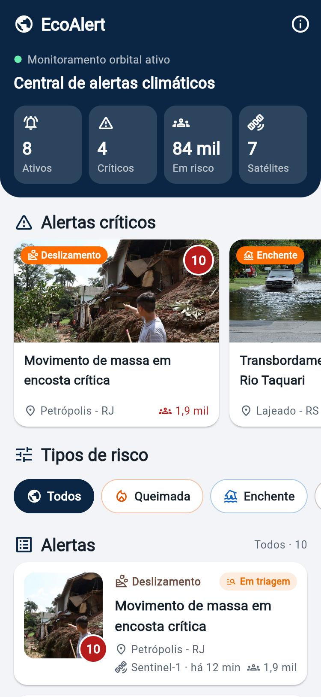
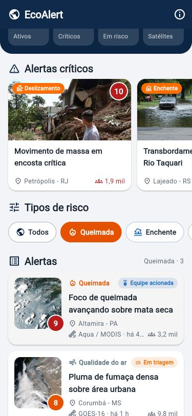
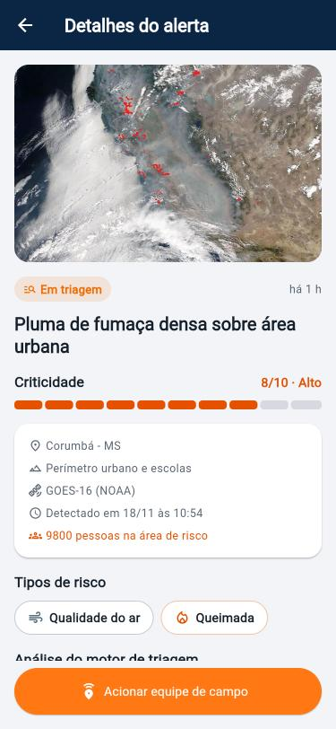
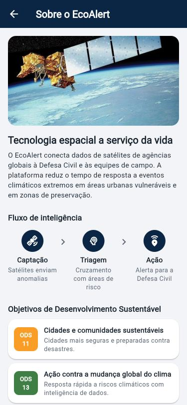

# EcoAlert: alertas de riscos climáticos via satélite

> Global Solution 2026.2 · Desenvolvimento Cross-Platform (Flutter/Dart) · Tema **CitizenTech**

## Desenvolvedores

| Nome completo | RM |
|---|---|
| Davi Budin Pina | RM560135 |

## Tema da Global Solution

**CitizenTech** são tecnologias criadas a partir das necessidades reais das pessoas, para tornar a
vida mais segura, simples e sustentável. Entre as sugestões do desafio está criar *"sistemas de
previsão de enchentes, deslizamentos, incêndios e ondas de calor com alertas direcionados à
população"*.

## Descrição da solução

O **EcoAlert** é uma plataforma de tecnologia espacial voltada à gestão de riscos climáticos
extremos. Ela leva dados orbitais de agências globais (NASA, ESA, NOAA e INPE) até a Defesa Civil e
os postos avançados de campo. Assim, o tempo de resposta cai e catástrofes podem ser evitadas em
áreas urbanas vulneráveis e em zonas de preservação ambiental.

O fluxo de inteligência tem três etapas:

1. **Captação**: satélites fazem varreduras contínuas e enviam anomalias térmicas, atmosféricas
   ou hidrológicas.
2. **Triagem e severidade**: o motor de inteligência cruza as anomalias com o cadastro de áreas
   vulneráveis (encostas críticas, matas secas e zonas de transbordamento) e dá uma nota de
   **criticidade de 1 a 10**.
3. **Ação imediata**: alertas geográficos são enviados às equipes de resgate e às centrais
   metropolitanas.

O **aplicativo mobile** é a ponta dessa cadeia, usada pelo operador da Defesa Civil ou pela equipe
de campo. Com ele, o usuário:

- acompanha os **indicadores** da central (alertas ativos, críticos, pessoas em risco e satélites);
- vê os **alertas críticos** em destaque;
- **filtra** os alertas por tipo de risco (queimada, enchente, deslizamento, tempestade, onda de
  calor, seca e qualidade do ar);
- abre os **detalhes** de cada alerta (criticidade, área vulnerável, satélite de origem, horário
  e pessoas em risco);
- **aciona a equipe de campo**, o que muda o status do alerta para "Equipe acionada".

### ODS relacionados

- **ODS 11**: Cidades e comunidades sustentáveis (cidades mais seguras e preparadas contra desastres).
- **ODS 13**: Ação contra a mudança global do clima (resposta rápida a riscos climáticos).

## Fluxo de telas

```
┌───────────────────────────────┐  toque em um alerta  ┌──────────────────────────────┐
│ Home (Central de alertas)     │ ───────────────────▶ │ Detalhes do alerta           │
│ • Painel de indicadores       │                      │ • Imagem (Hero animation)    │
│ • Alertas críticos (horizontal)│ ◀─────────────────── │ • Medidor de criticidade 1-10│
│ • Tipos de risco (horizontal) │  voltar (status      │ • Local, área, satélite      │
│ • Alertas (lista vertical)    │   atualizado)        │ • Botão "Acionar equipe"     │
└───────────────────────────────┘                      └──────────────────────────────┘
          │ ícone (i)
          ▼
┌───────────────────────────────┐
│ Sobre o EcoAlert              │
│ • Fluxo de inteligência       │
│ • ODS 11 e 13                 │
└───────────────────────────────┘
```

## Prints das telas

| Home | Filtro por tipo de risco | Detalhes do alerta | Sobre |
|---|---|---|---|
|  |  |  |  |

## API utilizada

Esta versão do app **não consome API externa**. Conforme o enunciado permite, os alertas ficam em
memória no `AlertaRepository`, simulando a saída do motor de triagem. O repositório isola a origem
dos dados. Assim, ele pode ser trocado pela API de disparo de notificações da plataforma (o
microsserviço previsto na arquitetura de nuvem do EcoAlert) sem alterar as telas.

As imagens são locais (`Image.asset`), em `assets/images/`. A origem delas está nos créditos abaixo.

## Arquitetura

```
lib/
├── main.dart                         # MaterialApp + tema
├── models/
│   ├── alerta.dart                   # classe de modelo Alerta
│   ├── tipo_risco.dart               # enum TipoRisco (+ enum TipoAnomalia)
│   ├── status_alerta.dart            # enum StatusAlerta (fluxo de inteligência)
│   └── fonte_orbital.dart            # enum FonteOrbital (satélite + agência)
├── repositories/
│   └── alerta_repository.dart        # fonte única dos dados + consultas/filtros
├── screens/
│   ├── home_screen.dart              # StatefulWidget: filtro com setState
│   ├── detalhe_alerta_screen.dart    # StatefulWidget: acionar equipe com setState
│   └── sobre_screen.dart             # StatelessWidget: proposta e ODS
├── widgets/                          # componentes reutilizáveis
│   ├── alerta_card.dart              # item da lista principal
│   ├── alerta_critico_card.dart      # item da lista de destaques
│   ├── alertas_criticos_lista.dart   # ListView.builder horizontal (destaques)
│   ├── tipo_risco_chip.dart          # item de categoria (reusado no detalhe)
│   ├── tipos_risco_bar.dart          # ListView.separated horizontal (categorias)
│   ├── alerta_imagem.dart            # Image.asset com fallback (reusado em 3 lugares)
│   ├── criticidade_badge.dart        # selo da nota 1-10 (reusado em 2 cards)
│   ├── criticidade_medidor.dart      # barra de criticidade
│   ├── status_badge.dart             # selo de status (reusado no card e no detalhe)
│   ├── info_item.dart                # ícone + texto (reusado em todos os cards)
│   ├── painel_resumo.dart            # cabeçalho com indicadores
│   ├── resumo_card.dart              # indicador numérico
│   ├── fluxo_inteligencia.dart       # captação → triagem → ação
│   ├── secao_titulo.dart             # título padrão das seções
│   └── lista_vazia.dart              # estado vazio do filtro
├── theme/app_theme.dart              # cores, espaçamentos e tipografia
└── utils/formatadores.dart           # "há 12 min", "12,4 mil", datas
```

**Camadas**

- **Models**: classes Dart tipadas, com construtor. `Alerta` tem `List<TipoRisco> tipos` (um alerta
  pode ter vários tipos de risco), `int criticidade` (1 a 10) e `bool destaque`.
- **Enums**: `TipoRisco`, `StatusAlerta` e `FonteOrbital` são *enhanced enums* com rótulo, ícone,
  cor e agência. Nenhuma regra de filtragem usa strings.
- **Repository**: `AlertaRepository` centraliza a lista de objetos e expõe `obterTodos()`
  (ordenados por criticidade), `obterPorTipo(TipoRisco?)`, `obterCriticos()`, os indicadores e
  `acionarEquipe()`. A mesma instância é usada pela Home e pelos Detalhes.
- **Screens**: guardam apenas o estado da tela. O filtro é aplicado em `_selecionarTipo()`, dentro
  de `setState`, **fora** do método `build`.
- **Widgets**: componentes visuais `StatelessWidget`, reaproveitados entre telas e listas.

**Mapeamento dos requisitos**

| Requisito | Onde |
|---|---|
| Lista vertical (`ListView.builder`, ≥ 5 registros, Card, imagem, título + 2 informações) | `home_screen.dart` + `alerta_card.dart` (10 alertas) |
| Lista horizontal de categorias (`Axis.horizontal`, ≥ 5, "Todos", destaque visual, `setState`, enum) | `tipos_risco_bar.dart`, `tipo_risco_chip.dart`, `home_screen.dart` (7 tipos + Todos) |
| Lista horizontal de destaques (`ListView.builder`, ≥ 3, filtrados pelo atributo `destaque`) | `alertas_criticos_lista.dart`, `alerta_critico_card.dart`, `obterCriticos()` (4 críticos) |
| Modelos e enums | `models/` |
| Repositório | `repositories/alerta_repository.dart` |
| Scaffold, AppBar, Column, Row, Card, ListView, Padding, Expanded, Text, Icon, Image.asset | usados nas telas e nos widgets |
| ≥ 3 widgets personalizados reutilizáveis | 15 widgets em `lib/widgets/` |

## Como executar

Pré-requisito: Flutter 3.29 ou superior.

```bash
flutter pub get
flutter run          # emulador Android, iOS, Chrome ou Windows
flutter test         # testes do repositório e da tela inicial
```

## Vídeo pitch

Link do YouTube: _adicionar o link público do vídeo aqui_

## Créditos das imagens

Imagens do [Wikimedia Commons](https://commons.wikimedia.org), usadas para fins educacionais:

| Arquivo | Origem |
|---|---|
| `queimada.jpg` | File:Fires Arrive in the Amazon Rainforest (1489375).jpg (NASA) |
| `fumaca.jpg` | File:August 2020 NASA-Terra-Smoke-Covered-California.jpg (NASA) |
| `alagamento.jpg` | File:FEMA - 32096 - Cars drives though flooded street in an Oklahoma neighborhood.jpg (domínio público) |
| `deslizamento.jpg` | File:Chuvas em Petrópolis - Fevereiro 2022 01.jpg |
| `deslizamento_satelite.jpg` | File:Deadly landslides in Petropolis, Brazil (Copernicus).jpg (ESA/Copernicus) |
| `tempestade.jpg` | File:Supercell-thunderstorm-in-Kansas.jpg |
| `seca.jpg` | File:Cracked earth - Flickr - Al Jazeera English.jpg |
| `calor.jpg` | File:NASA SLC Urban Heat Island Effect Roof.jpg (NASA) |
| `termica.png` | File:Thermal Imagery of the Ferguson Fire in Northern California (NESDIS 2018-07-18).png (NOAA) |
| `arvore.jpg` | File:Fallen tree, 16th Street NW.jpg |
| `satelite.jpg` | File:Landsat 7 Artist’s Concept in Orbit.jpg (NASA) |
